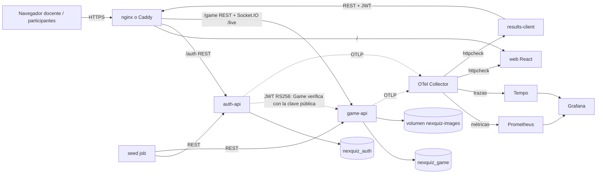
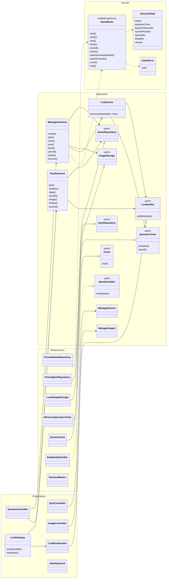
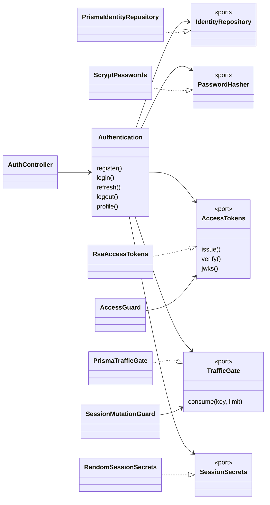
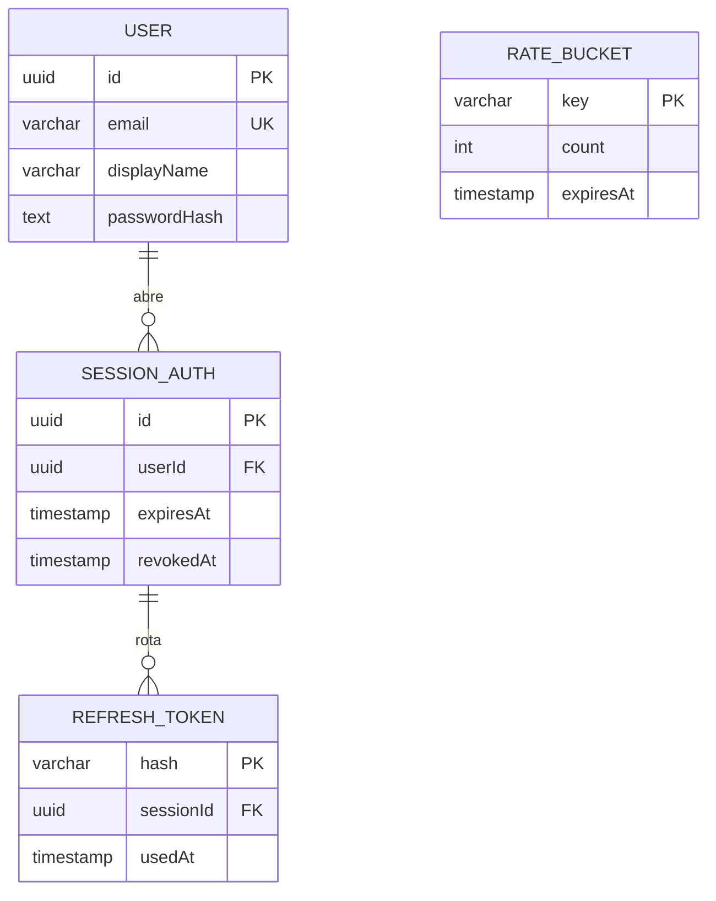
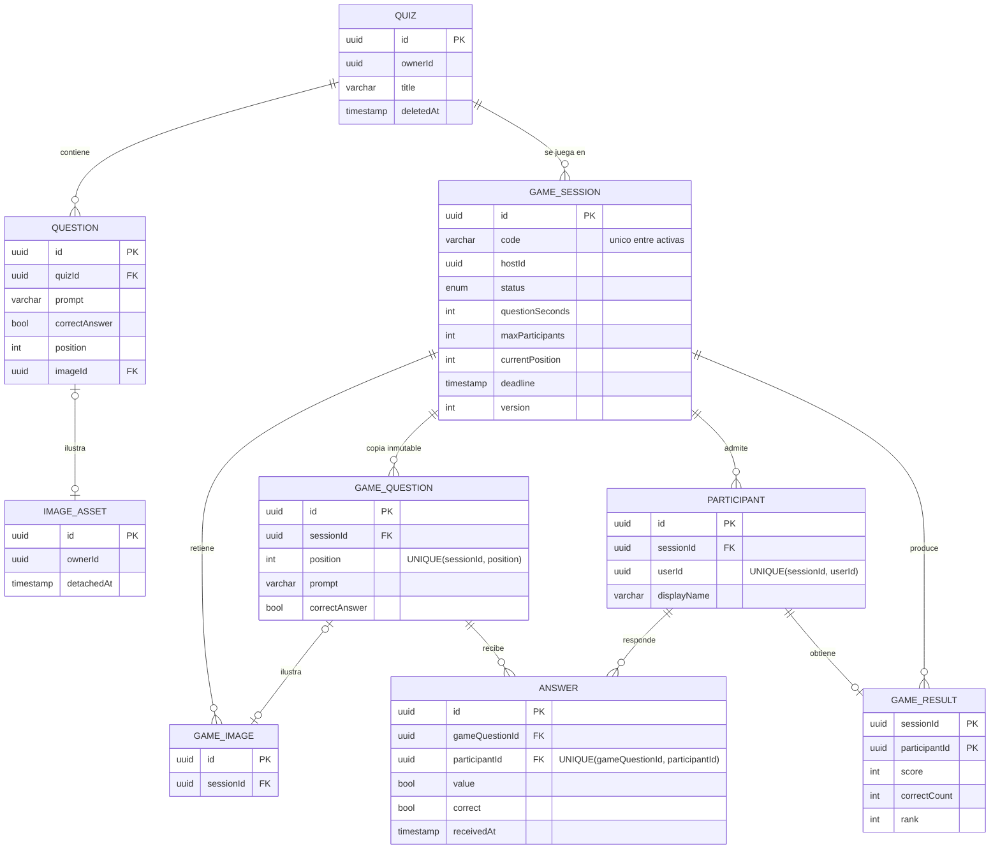

# Especificación — NexQuiz, evaluaciones en vivo para ProfeLink

Las especificaciones normativas están en OpenSpec (`openspec/specs/*`), y cada hito tiene su cambio archivado en `openspec/changes/archive/`. Este documento las resume para la entrega.

## 1. Alcance

**Problema.** Hacer evaluaciones cortas de Verdadero o Falso durante una clase, con la participación simultánea de los estudiantes desde sus dispositivos, y guardar los resultados.

| Incluye | No incluye |
| --- | --- |
| Registro, login, perfil y nombre visible (Auth separado) | Recuperación de contraseña, verificación de correo, MFA |
| CRUD de cuestionarios y preguntas V/F con imagen (JPEG, PNG o WebP, ≤ 5 MiB, ≤ 16 MP) | Otros tipos de pregunta, puntaje por velocidad |
| Salas con código, lobby, partida en vivo, revelación y clasificación | Varias instancias de Game (escalado horizontal) |
| API REST de perfiles, cuestionarios, sesiones y resultados; OpenAPI/Scalar por API | Roles administrativos |
| Canal Socket.IO con autenticación, aislamiento por sala y recuperación de estado | |
| Cliente adicional independiente, seed de demostración, scripts de inicio, Docker y Compose, observabilidad | |

## 2. Reglas del juego

Son funciones puras en `apps/game-api/src/domain/game.ts`, con pruebas unitarias.

1. **Estados:** `LOBBY → QUESTION_OPEN → QUESTION_CLOSED → (QUESTION_OPEN …) → FINISHED`. Desde cualquier estado no terminal se puede pasar a `CANCELLED`. Cada transición incrementa `version`.
2. **Control:** solo el anfitrión (el `sub` del JWT debe ser igual a `hostId`) inicia, cierra, avanza, termina o cancela. Avanzar solo es posible con la pregunta cerrada, y después de la última pregunta se termina la partida.
3. **Ingreso:** el código tiene 6 caracteres sin símbolos ambiguos y es único entre las salas activas. Los participantes nuevos solo entran en `LOBBY`, mientras haya cupo (`GAME_MAX_PARTICIPANTS`, 50 por defecto). Un participante existente puede volver a entrar en cualquier estado activo (reconexión). El anfitrión no participa.
4. **Copia inmutable:** al crear la sala se copian las preguntas, respuestas, orden e imágenes. Editar el cuestionario después no afecta la partida.
5. **Tiempo:** el servidor fija `deadline = apertura + segundos` (entre 5 y 120). Se acepta una respuesta si `recibida ≤ deadline`, si la pregunta es la actual y si está abierta; si no, `409 ANSWER_WINDOW_CLOSED`. El temporizador cierra la pregunta y, si el proceso se reinicia, la recupera al arrancar o al primer acceso.
6. **Una respuesta:** `UNIQUE(gameQuestionId, participantId)` en la base de datos. Un reenvío devuelve la primera respuesta con `duplicate: true`.
7. **Revelación:** la respuesta correcta y el puntaje de la pregunta en curso no se envían mientras está abierta.
8. **Puntaje:** 1 punto por acierto y 0 por error o falta de respuesta. La clasificación usa ranking de competición: los empates comparten posición (1, 1, 3) y se ordenan por nombre. Se guarda al terminar, en la misma transacción.

## 3. Arquitectura

**Estilo:** servicios desplegables por separado. Auth y Game son APIs independientes, cada una con su base de datos. Game es un **monolito modular** con los módulos de cuestionarios, imágenes, salas y partida en vivo, que comparten proceso y transacciones. La web y el cliente adicional son aplicaciones estáticas que consumen las APIs por red.

**Organización interna:** cada API usa **N-Capas** (Domain → Application → Infrastructure/Presentation) y la composición se hace en `modules`. `scripts/check-architecture.cjs` falla si una capa interna importa frameworks, si hay ciclos o si una aplicación importa código de otra.

| Dónde está cada responsabilidad (Game) | Capa |
| --- | --- |
| Reglas: estados, ventana de respuesta, puntaje, clasificación, códigos | `domain/game.ts`, `domain/quiz.ts` |
| Casos de uso: crear sala, unirse, controlar la partida, responder, vistas, historial | `application/manage-sessions.ts`, `play-sessions.ts`, `live-events.ts`, `manage-quizzes.ts`, `manage-images.ts` |
| Entrada HTTP y en vivo | `presentation/*.controller.ts`, `live.gateway.ts` |
| Acceso a datos y recursos | `infrastructure/prisma-*.repository.ts`, `local-image.storage.ts`, `question-scheduler.ts`, `rsa-identity-verifier.ts` |

## 4. Diagrama de clases (Game y Auth)

## 5. Modelo de datos implementado

Hay dos bases separadas. No existen claves foráneas entre ellas: `ownerId`, `hostId` y `userId` en Game son el `sub` del JWT de Auth.

Las migraciones son aditivas y se aplican automáticamente: `apps/auth-api/prisma/migrations` y `apps/game-api/prisma/migrations`. Las restricciones `CHECK` repiten las reglas del dominio: formato del código, rango de segundos, pregunta abierta con `deadline` y puntajes no negativos.

## 6. API y eventos en vivo

- **REST:** OpenAPI y Scalar de cada API (`/auth/docs`, `/game/docs`). Hay un resumen en [docs/api/README.md](api/README.md).
- **En vivo:** [docs/api/realtime.md](api/realtime.md) describe la conexión, la autenticación, los mensajes, cada evento con sus datos y destinatario, el orden por `version`, la recuperación y el reloj.
- **Consumo independiente:** [apps/results-client/README.md](../apps/results-client/README.md).
