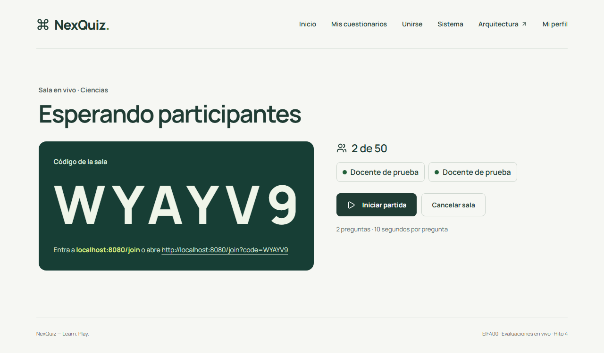
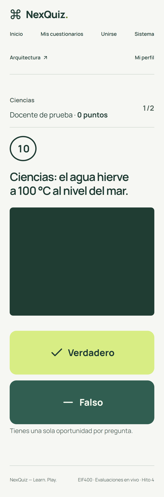
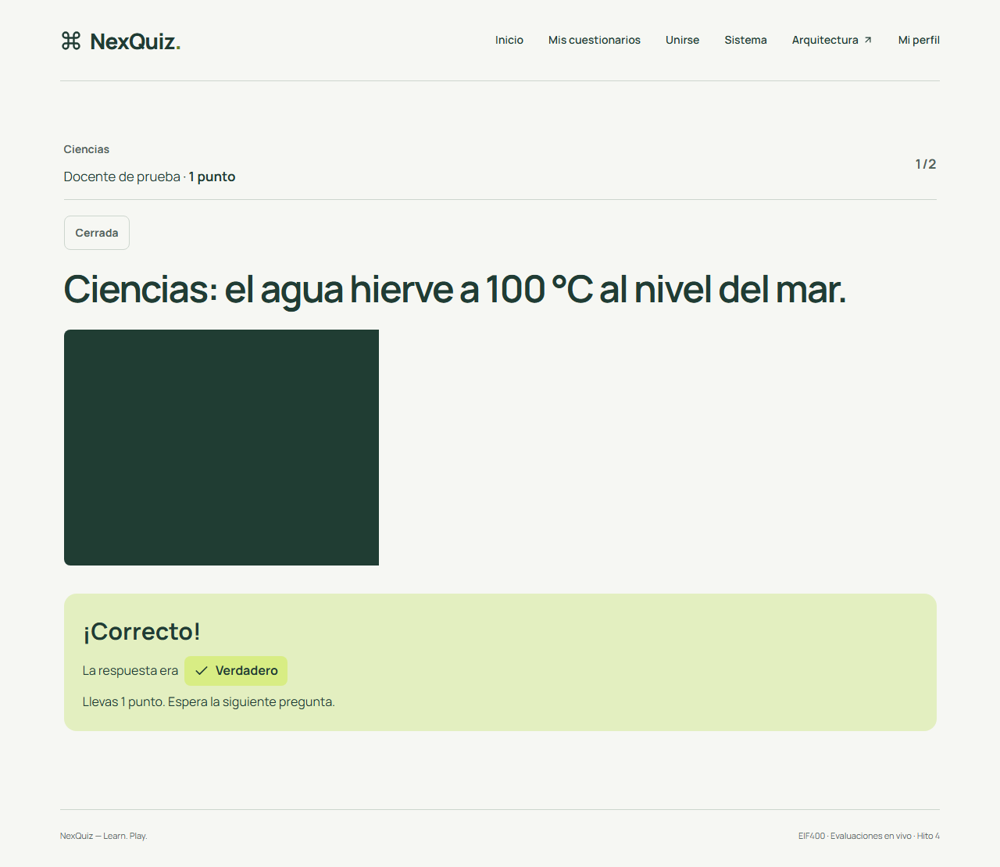
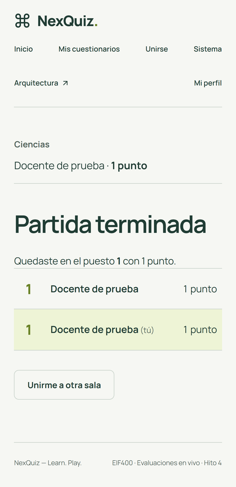

# NexQuiz — Hito 4: partida en vivo

Fecha: 31 de octubre de 2026. Ejecutado sobre el monorepo local y el stack Docker Compose de NexQuiz (`http://localhost:8080`). Todas las cuentas de prueba son sintéticas (`example.invalid`). Las pruebas que necesitan PostgreSQL aislado se ejecutaron en un contenedor desechable `postgres:17.7-bookworm`, eliminado al terminar.

## Qué se entrega

- **Salas:** el anfitrión abre una sala desde un cuestionario propio y recibe un código de seis caracteres sin símbolos ambiguos. Ve quién se une y en qué estado está cada conexión, y puede iniciar o cancelar la sala.
- **Copia inmutable:** al crear la sala, las preguntas, respuestas, orden e imágenes se copian. Editar o borrar el cuestionario después no altera la partida.
- **Partida:** la pregunta llega a todos a la vez, con su imagen, cuenta regresiva y dos botones grandes. El servidor cierra la pregunta al vencer el tiempo; el anfitrión puede cerrarla antes y avanzar después del cierre.
- **Respuestas y puntaje:** una respuesta por participante y pregunta, garantizada por `UNIQUE(gameQuestionId, participantId)`. Los reenvíos devuelven la primera respuesta (`duplicate: true`) y las respuestas tardías reciben `409 ANSWER_WINDOW_CLOSED`. La respuesta correcta y el puntaje de la pregunta en curso no se revelan hasta el cierre. Cada acierto vale un punto; los errores y la falta de respuesta valen cero.
- **Resultados:** la clasificación se guarda en la misma transacción que termina la partida. Los empates comparten posición (1, 1, 3).
- **Canal en vivo:** Socket.IO en el namespace `/live`, con autenticación RS256 en el handshake, renovación (`auth:renew`) y desconexión al vencer el token. Las salas están aisladas y cada evento va a la sala, solo al anfitrión o solo al participante dueño. Protocolo completo: [docs/api/realtime.md](../api/realtime.md).
- **Web:** panel "Jugar en vivo" en el editor, pantallas `/host/:id`, `/join`, `/play/:id` y `/results/:id`. Después del login se vuelve a la página pedida, por ejemplo `/join?code=…`. Hay avisos de conexión perdida y mensajes claros para código inválido, sala llena, partida iniciada y acceso vencido.

## Arquitectura

Las reglas del juego están en `domain/game.ts`: máquina de estados, ventana de respuesta, puntaje, clasificación, códigos y quién puede unirse. Son funciones puras, sin NestJS ni Prisma.

| Capa | Componentes |
| --- | --- |
| Aplicación (casos de uso y puertos) | `ManageSessions` (anfitrión), `PlaySessions` (participante y vistas), `LiveEvents`. Puertos: `GameRepository`, `ImageStorage`, `LiveNotifier`, `QuestionTimer`, `Clock` |
| Infraestructura | `PrismaGameRepository` (bloqueos `FOR UPDATE`/`FOR SHARE`, lock consultivo para códigos), `LocalImageStorage.copy`, temporizador en proceso con recuperación al arrancar |
| Presentación | `SessionController` (REST + OpenAPI), `LiveGateway` y `LiveBroadcaster` (Socket.IO) |

Los comandos van por REST y el socket solo informa. `scripts/check-architecture.cjs` pasa: no hay imports prohibidos ni ciclos.

Migración aditiva: `20261031000000_live_game`. Crea 6 tablas, un índice único parcial para el código activo y restricciones `CHECK` que repiten las reglas del dominio. No toca `nexquiz_auth`.

## Comprobaciones obligatorias

| Caso | Evidencia | Resultado |
| --- | --- | --- |
| Acceso y permisos | `session-http.db.spec.ts`, `live.spec.ts` (3.ª prueba) | Un participante recibe 403 al iniciar o avanzar, y 404 al editar el quiz o agregarle preguntas. Un usuario ajeno recibe 404 en estado, resultados, imágenes y suscripción. El canal en vivo rechaza handshakes sin token válido. **Pasa** |
| Juego simultáneo | `live-gateway.db.spec.ts`, `live.spec.ts` (1.ª y 2.ª prueba) | Los participantes en escritorio y celular reciben la misma pregunta e imagen. Con dos salas a la vez no se mezclan preguntas, conteos ni resultados. **Pasa** |
| Respuestas válidas | `game-persistence.test.cjs`, `session-http.db.spec.ts` | 10 envíos concurrentes guardan una sola respuesta. La respuesta tardía recibe 409. La respuesta correcta solo aparece al cierre y el puntaje no anticipa el acierto. **Pasa** |
| Reconexión | `live.spec.ts` (2.ª prueba), `live-gateway.db.spec.ts` | Con el navegador sin red, aparece el aviso; al volver la red, o al recargar la página, se recupera la misma pregunta con la respuesta marcada. `rejoined: true`, sin duplicar la participación (1 participante, 1 respuesta). **Pasa** |
| Persistencia | Script de reinicio (abajo) y suites de base de datos | Después de `docker compose restart game-api`, la clasificación terminada sigue igual, la pregunta abierta quedó cerrada y el participante vuelve a la misma sala. **Pasa** |
| Consumo independiente | — | Corresponde al Hito 5 (cliente adicional). |

**Prueba de reinicio real.** Se usó el stack Compose con 10 s por pregunta:

- Antes del reinicio: clasificación `[["Ana",1,1]]` y una pregunta abierta.
- `game-api` volvió a estar listo en 6,0 s.
- Después del reinicio: la pregunta estaba en `QUESTION_CLOSED`, la clasificación seguía siendo `[["Ana",1,1]]`, `rejoined: true` y había 1 participante.

## Resultados

| Suite | Cantidad | Resultado |
| --- | --- | --- |
| Game, unitarias (`pnpm test`) | 99 (más 7 que se omiten sin base de datos) | Pasan |
| Game, con PostgreSQL desechable (`pnpm test:game:http`) | 7: partida HTTP completa, OpenAPI y canal en vivo | Pasan |
| Persistencia (`pnpm test:game:db`) | 8 | Pasan |
| Auth, unitarias | 24 | Pasan |
| Navegador, partida en vivo (`pnpm test:live`) | 3 | Pasan |
| Regresión: base, identidad, cuestionarios, documentación | 4 + 10 + 11 + 4 | Pasan |
| Lint, typecheck y arquitectura (`pnpm lint`, `pnpm typecheck`) | — | Pasan |
| Build Docker de Game con lockfile congelado | — | Pasa |

**Proxy.** A través de nginx (`/game/socket.io`), un token inválido recibe `UNAUTHORIZED` desde Game, lo que confirma el enrutamiento y el upgrade. `/game/docs` responde 200 y `/game/openapi.json` publica los 11 endpoints de sesiones.

## Capturas

| Anfitrión, lobby | Celular, pregunta | Escritorio, revelación | Celular, clasificación |
| --- | --- | --- | --- |
|  |  |  |  |

La revisión visual encontró y corrigió tres defectos:

- la cuenta regresiva se estiraba como un óvalo en el celular;
- las imágenes pequeñas no se escalaban;
- el texto del lobby se superponía a los botones.

En el celular no hay desplazamiento horizontal.

## Hallazgos corregidos durante el hito

- `LocalImageStorage.copy` sobrescribía una imagen existente. Ahora usa un `link` atómico y responde `CONFLICT`.
- En `StrictMode`, los actualizadores de estado con efectos podían descartar eventos. El hook usa ahora un estado espejo en una referencia.
- En Chromium, la caída de red no cortaba el WebSocket hasta el timeout del ping (unos 45 s). Ahora el evento `offline` del navegador marca la desconexión enseguida, y `online` reconecta y resincroniza.
- La presencia se separó del registro (`participant:online/offline` frente a `participant:joined`), para no duplicar avisos al anfitrión.

## Límites conocidos

- Una sola instancia de Game: las salas de Socket.IO y los temporizadores viven en el proceso. Escalar a varias instancias requeriría el adaptador Redis.
- Si el temporizador cierra la pregunta exactamente en el `deadline`, una respuesta que llegue en ese mismo milisegundo puede rechazarse. El reloj del servidor decide.
- El límite de participantes por sala es `GAME_MAX_PARTICIPANTS` (50 por defecto). La capacidad real medida se documenta en el Hito 6.
- En este equipo, el puerto 5432 pertenece a otro proyecto. El stack se levantó con `POSTGRES_PORT=55432`, como ya indicaba el README.
