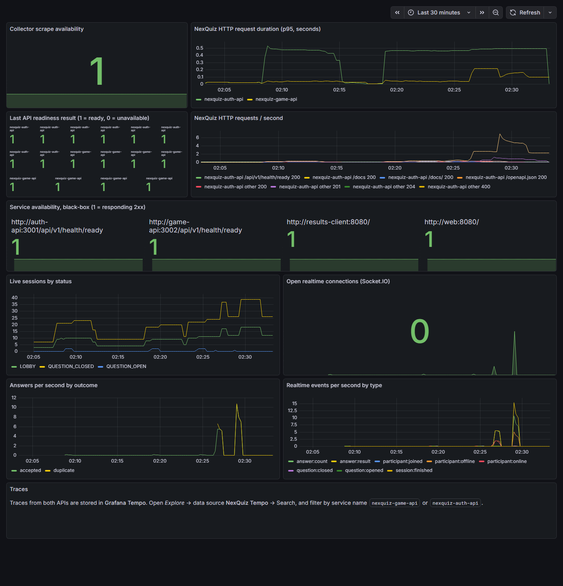

# NexQuiz — Hito 6: observabilidad, capacidad y preparación de producción

Fecha: 31 de octubre de 2026. Las pruebas se hicieron en el stack Compose local, en una máquina con Docker Desktop (12 CPU y 7,4 GB para Docker). El generador de carga corrió en la misma máquina.

**Estado: falta publicar en Docker Hub y desplegar en un VPS con URL pública.** Las dos tareas requieren la cuenta y el servidor del equipo. Todo lo demás está listo y verificado; los pasos exactos están en [production.md](../deployment/production.md#pasos-para-publicar-y-desplegar-hito-6).

## Observabilidad

| Señal | Implementación | Verificación |
| --- | --- | --- |
| Métricas HTTP de Auth y Game | SDK de OpenTelemetry → Collector → Prometheus (ya existía) | `verify-monitoring.cjs` |
| **Trazas de Auth y Game** | Collector → **Grafana Tempo 2.8.2** (volumen `nexquiz-tempo-data`, 72 h). Datasource "NexQuiz Tempo" provisionado | `verify-monitoring.cjs` busca trazas de los dos servicios por la API de Grafana; [captura](img/hito-6/tempo-traces.png) |
| **Disponibilidad de cada servicio**, incluidos la web estática y el cliente adicional | Receptor `httpcheck` del Collector cada 15 s → `httpcheck_status` | El chequeo falla si algún servicio no responde 2xx |
| **Métricas del juego** | `nexquiz_game_sessions{status}` (consulta a PostgreSQL), `nexquiz_live_connections`, `nexquiz_answers_total{outcome}` y `nexquiz_live_events_total{type}`. Todas usan etiquetas fijas, sin identificadores de usuario ni de sesión | Dashboard con datos de partidas reales ([captura](img/hito-6/grafana-dashboard.png)) |

## Capacidad: participantes simultáneos

Se usó `scripts/load-test.mjs`. Cada participante simulado tiene su propia cuenta, se une por REST, se suscribe por Socket.IO, recibe cada pregunta, responde **dos veces a la vez** y debe terminar con el puntaje exacto que el script calculó. Cada partida tiene 3 preguntas.

| Participantes | Correctitud | Unirse p95 | Difusión de pregunta p50 / p95 / máx. | Respuesta p50 / p95 | Resultado personal p95 |
| --- | --- | --- | --- | --- | --- |
| 10 | 0 errores, 0 puntajes distintos, 30/30 duplicados rechazados | 137 ms | 30 / 35 / 35 ms | 133 / 185 ms | 65 ms |
| 30 | igual, 90/90 | 310 ms | 20 / 34 / 35 ms | 270 / 436 ms | 78 ms |
| **50** | igual, 150/150 | 474 ms | 26 / 33 / 34 ms | 411 / 689 ms | 132 ms |
| 100 | igual, 300/300 | 1247 ms | 33 / 54 / 56 ms | 750 / 1381 ms | 186 ms |
| 150 | igual, 450/450 | 1597 ms | 28 / 40 / 43 ms | 962 / 1751 ms | 239 ms |

En todas las corridas, la sala rechazó con `ROOM_FULL` al participante que excedía su límite.

**Límite definido: `GAME_MAX_PARTICIPANTS=50`** (valor por defecto), con amplio margen en esta máquina. Hasta 150 participantes no hubo errores, pero la latencia de respuesta crece de forma lineal. Esa latencia es un peor caso, porque todos responden a la vez y dos veces; aun así queda muy por debajo de una ventana de 10 a 30 segundos. **En el VPS hay que repetir la prueba** (`BASE_URL=https://<dominio> node scripts/load-test.mjs 10 30 50`) y fijar el límite según ese hardware.

Para las corridas de 100 y 150 se subió temporalmente `GAME_MAX_PARTICIPANTS` y `AUTH_SOURCE_LIMIT`, porque el script registra todas las cuentas desde una sola IP. Después se restauraron 50 y 300.

### Optimización de consultas (31 de octubre)

Se redujeron las consultas del camino crítico:

- **Responder:** una sola consulta busca al participante, la pregunta y la respuesta previa. Ya no se relee la respuesta insertada, y el conteo que recibe el docente se calcula con `COUNT` después del commit, en lugar de leer todas las respuestas de la pregunta.
- **Cerrar una pregunta:** se calcula el puntaje de toda la sala con un `GROUP BY`, en lugar de hacer una consulta por participante.
- **Unirse y suscribirse:** ya no repiten la consulta del conteo ni la de autorización.

Mediana de dos corridas en caliente con 50 participantes, misma máquina:

| Métrica | Antes | Después |
| --- | --- | --- |
| Respuesta p50 | ~410 ms | ~318 ms |
| Respuesta p95 | ~660 ms | ~580 ms |
| Resultado por participante tras cerrar, p95 | ~100 ms | ~55 ms |

Siguió sin errores, sin puntajes incorrectos y sin respuestas duplicadas.

### Limpieza de código (1 de noviembre)

- **Código muerto eliminado:** `score()` del dominio (lo reemplazó el conteo en SQL), el símbolo `IDENTITY_VERIFIER` y el archivo de alias `token-issuer.port.ts` de Auth; ninguno tenía usos.
- **Duplicación eliminada:** la web tenía dos clientes HTTP casi idénticos para Game (`quizzes.ts` y `live.ts`); ahora comparten `gameFetch` y cada uno solo define sus mensajes. Siete pantallas repetían la carga con `AbortController` y ahora usan `useLoad` y `useBlobUrl`. La paginación, la limpieza del código de sala y los plurales ("1 pregunta", "3 preguntas") son funciones compartidas.
- **Lógica más clara:** la validación de JWT de Auth y Game pasó de una condición de una línea a una función que nombra cada regla. Los filtros de error usan tablas `Record<código, estado>` completas, así que un código nuevo sin estado HTTP no compila. Los cinco comandos del anfitrión comparten un método, y la edición parcial de cuestionarios valida cada campo directamente en lugar de rellenar el resto con valores ficticios.
- **Rendimiento:** Auth derivaba la clave pública del par RSA en cada verificación de token; ahora la calcula una vez.

**Defecto corregido:** el editor de cuestionarios, la biblioteca y las imágenes se recargaban cada vez que la sesión renovaba el token (cada 4 min 30 s). En el editor eso desmontaba el formulario abierto y se perdía lo escrito. Ahora la recarga depende solo del cuestionario o la página, y las recargas después de guardar mantienen el editor en pantalla.

## Defectos encontrados y corregidos en este hito

| Defecto | Impacto en clase | Corrección y prueba |
| --- | --- | --- |
| nginx resolvía `auth-api` y `game-api` una sola vez al arrancar | Recrear una API (por ejemplo, al actualizarla) le asigna otra IP, y la web respondía `502` hasta reiniciarse | `resolver 127.0.0.11` con variables en `proxy_pass`. Se reprodujo con `--force-recreate`: Auth pasó de 172.21.0.8 a .9 y la web siguió respondiendo 200 |
| Límite de Auth: 100 operaciones por IP cada 15 min, y detrás del proxy todos compartían la IP del proxy | 50 estudiantes renovando el token cada 270 s se habrían quedado sin servicio a mitad de la partida | `TRUST_PROXY=uniquelocal` (solo nginx o Caddy en la red privada de Compose) más `X-Forwarded-For`. Cuotas separadas: 300 de credenciales y 3000 de renovación. Prueba unitaria `source-limits.spec.ts` (Auth 27/27) |
| El CSP de nginx se elegía con `$uri`, que el `rewrite` modifica | Scalar se veía en blanco a través del proxy | `map $request_uri`. Identidad 10/10, incluidas las pruebas de Scalar por el proxy |
| Las salas abandonadas (pestaña cerrada, lobby olvidado) quedaban activas para siempre | Códigos reservados sin fin y métricas infladas | Se cancelan tras 3 h sin cambios de estado (barrido cada 10 min) y se avisa con `session:cancelled`. Pruebas de integración y unitaria |

## Producción preparada

- `docker-compose.prod.yml` incluye las 4 imágenes del equipo, Tempo, el seed de demostración y el cliente adicional en `https://<dominio>/client/` (mismo origen, así que el CORS de producción sigue limitado a HTTPS). También tiene `TRUST_PROXY` y las cuotas de Auth. Se validó con `docker compose config` usando un entorno sintético; el Caddyfile pasó `caddy validate`.
- `scripts/release.cjs` construye las 4 imágenes e imprime los `docker push` exactos.
- `scripts/start.sh --hub` arranca desde Docker Hub. Probado con `--no-build` usando las imágenes locales.

## Verificación final

| Suite | Resultado |
| --- | --- |
| Monorepo (`pnpm lint`, `pnpm typecheck`, `pnpm test`) | Pasa: Auth 27, Game 100 (más 7 que necesitan base de datos), tooling 4, Scalar 12 y arquitectura |
| Game con PostgreSQL desechable | 107/107; persistencia 9/9 |
| Navegador | Partida en vivo y cliente 5/5, base 4/4, identidad 10/10, cuestionarios 11/11, documentación 4/4 |
| Monitoreo (`verify-monitoring.cjs`) | Pasa: métricas, disponibilidad, métricas del juego y trazas de las dos APIs |
| Diagramas Mermaid de `docs/specification.md` | Los 5 renderizan sin errores |

## Pendiente (requiere al equipo)

1. Cuenta de Docker Hub, `node scripts/release.cjs` y `docker push` de las 4 imágenes.
2. VPS con DNS y HTTPS. Arrancar con `docker-compose.prod.yml` y anotar la URL pública en el README.
3. Prueba de carga y partida real con celulares en el VPS; ajustar `GAME_MAX_PARTICIPANTS` y anotar cuántos participantes hubo en la demostración.
4. Primer commit, repositorio remoto y PRs por integrante con los cambios de OpenSpec archivados. Sin esto no se pueden mostrar los aportes identificables de cada integrante.
